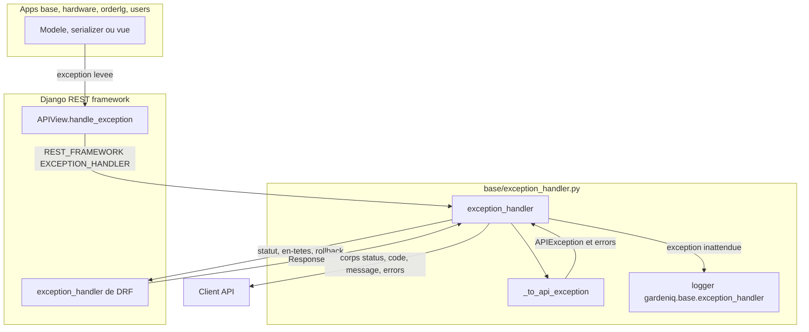
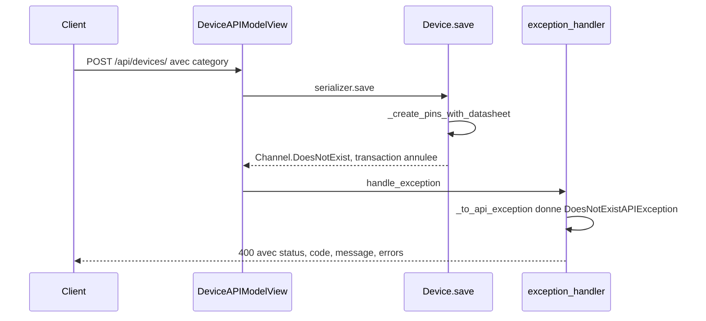

# Feature : format d'erreur de l'API

Dernière vérification : 2026-11-12 · 8760dab

Copie Notion : [Format d'erreur de l'API (back)](https://app.notion.com/p/41654287aae081609229f4faeb6eed33).

## Résumé

Toutes les erreurs de l'API REST (`/api/…`) renvoient le même corps JSON : `{"status", "code", "message", "errors"}`. Il est produit par le gestionnaire d'exceptions global de DRF, `gardeniq/base/exception_handler.py`. Ce gestionnaire traduit aussi les exceptions de Django et du projet qui finissaient auparavant en page 500 HTML. Périmètre : les vues DRF ; l'admin Django et les URL hors des routeurs DRF n'en relèvent pas.

## Contexte

Avant ce gestionnaire, chaque vue devait attraper ses erreurs attendues, et toute exception étrangère à DRF finissait en page 500 HTML de Django :
- `ProtectedError` à la suppression d'une catégorie utilisée ;
- `ValidationError` levée par un `save()` ;
- `DoesNotExist` levée par du code métier ;
- `IntegrityError`.

Les erreurs que DRF gérait déjà avaient plusieurs formes : `{"detail": "…"}`, `{"champ": ["…"]}` ou une simple liste. Le gestionnaire centralise la traduction et donne au front une seule forme à lire. Au moment du changement, le dépôt `gardenIQ-front` n'avait pas encore de code qui lise ces erreurs.

## Architecture

Les vues, serializers et modèles lèvent leurs exceptions sans les attraper. DRF (`APIView.handle_exception`) appelle le gestionnaire déclaré dans `REST_FRAMEWORK["EXCEPTION_HANDLER"]`, et celui-ci procède en trois temps :
1. `_to_api_exception` traduit l'exception en `APIException` de DRF.
2. Le gestionnaire d'origine de DRF construit la réponse : statut, en-têtes `WWW-Authenticate` et `Retry-After`, rollback de la transaction.
3. Le corps est remplacé par l'enveloppe.

Une exception inconnue est journalisée avec sa trace avant de devenir un 500 générique. Avec `DEBUG`, elle est laissée à Django, qui affiche sa page de debug. `base` n'importe que Django, DRF et `base.exceptions`, conformément au sens des imports entre apps.



*Figure 1 : chemin d'une exception, de la vue au client.*

## Flux / Comportement

Exemple déroulé : un `POST /api/devices/` avec une catégorie dont la datasheet cite un canal que le seeder n'a pas créé.
1. `Device.save()` crée les pins depuis la datasheet et lève `Channel.DoesNotExist`.
2. La transaction de `save()` annule la création du device.
3. Le gestionnaire traduit l'exception en 400 `does_not_exist`.



*Figure 2 : création d'un device dont la datasheet cite un canal absent de la base.*

```json
{
  "status": 400,
  "code": "does_not_exist",
  "message": "DeviceCategory `Pico`: channels not found in database ['analog']",
  "errors": {}
}
```

Les champs du corps :

| Champ | Contenu |
|---|---|
| `status` | Le code HTTP, identique à celui de la réponse. |
| `code` | Code machine stable, à utiliser dans la logique du client. |
| `message` | Texte lisible, en anglais (messages de DRF, pas de traduction). |
| `errors` | Toujours présent. Erreurs de validation par champ (forme DRF, imbriquée pour un serializer imbriqué), `non_field_errors` pour celles sans champ, objets bloquants pour un 409 de Django, `{}` sinon. |

Correspondance exception → réponse (`_to_api_exception`) :

| Exception levée | HTTP | `code` | `message` | `errors` |
|---|---|---|---|---|
| `ValidationError` de DRF (serializer) | 400 | `invalid` | `Invalid input.` | par champ, ou `non_field_errors` |
| Autres exceptions de DRF | leur statut | le leur : `parse_error`, `authentication_failed`, `not_authenticated`, `permission_denied`, `not_found`, `method_not_allowed`, `not_acceptable`, `unsupported_media_type`, `throttled` | leur `detail` | `{}` |
| `Http404`, `PermissionDenied` de Django | 404 / 403 | `not_found` / `permission_denied` | celui de DRF | `{}` |
| `ValidationError` de Django (`save()`, `clean()`) | 400 | `invalid` | `Invalid input.` | `message_dict`, ou `non_field_errors` |
| `ObjectDoesNotExist` (tout `Model.DoesNotExist`) | 400 | `does_not_exist` | message de l'exception | `{}` |
| `ProtectedError` / `RestrictedError` de Django | 409 | `protected` | `This object is used by other objects and cannot be deleted.` | objets bloquants par modèle |
| `ProtectedException` et sous-classes (`base/exceptions.py`) | 409 | `protected` | message de l'exception | `{}` |
| Toute autre exception (`IntegrityError`, `ValueError`…) | 500 (avec `DEBUG` : non traitée, page de debug de Django) | `server_error` | `Internal server error.` | `{}` |

*Tableau 1 : correspondances appliquées par le gestionnaire.*

Deux autres exemples de corps, pour une erreur de validation et pour un 409 de Django :

```json
{"status": 400, "code": "invalid", "message": "Invalid input.", "errors": {"name": ["This field is required."]}}
```

```json
{
  "status": 409,
  "code": "protected",
  "message": "This object is used by other objects and cannot be deleted.",
  "errors": {"devices": ["Device `Serre` : 12AB34567890DEAD : /dev/ttyUSB0"]}
}
```

## Configuration & Utilisation

| Clé | Valeur par défaut | Effet |
|---|---|---|
| `REST_FRAMEWORK["EXCEPTION_HANDLER"]` (`gardeniq/settings/third_party/rest_framework.py`) | `gardeniq.base.exception_handler.exception_handler` | Branche le gestionnaire sur toutes les vues DRF. |
| `REST_FRAMEWORK["NON_FIELD_ERRORS_KEY"]` | non défini : `non_field_errors` (défaut de DRF) | Clé des erreurs de validation sans champ dans `errors`. |
| `DEBUG` (variable `DJANGO_DEBUG` du `.env`) | `False` ; `true` dans `.env.example` (dev) | `True` : une exception imprévue n'est pas traitée, Django affiche sa page de debug avec la traceback. `False` : 500 JSON générique, détail dans les logs. |
| Logger `gardeniq.base.exception_handler` | aucune configuration `LOGGING` dans le projet | Les 500 y sont journalisées au niveau `ERROR` avec leur trace ; sans configuration, Python les écrit sur stderr. |

Côté back, lever l'exception là où l'erreur se produit, sans `try/except` ni `Response` d'erreur dans la vue :

```python
from rest_framework import exceptions

from gardeniq.base.exceptions import DeleteProtectedException
from gardeniq.base.models import Status

raise exceptions.PermissionDenied("Only administrators can assign groups.")  # 403 permission_denied
raise DeleteProtectedException()                                              # 409 protected
raise Status.DoesNotExist("No device status found.")                          # 400 does_not_exist
```

**Ajouter un cas.**
1. Créer une sous-classe d'`APIException` dans `gardeniq/base/exception_handler.py`, avec `status_code`, `default_detail` et `default_code`.
2. Ajouter sa branche dans `_to_api_exception`, avant le cas par défaut.
3. Ajouter son test dans `gardeniq/base/tests/test_exception_handler.py`.

**Bibliothèque qui renvoie son erreur en `Response`.** Une erreur qui ne lève pas d'exception contourne le gestionnaire : la convertir en exception dans la vue du projet. C'est le cas de knox, dont la limite de tokens est convertie dans `users/views/auth.py`.

Côté client, lire `code` pour décider, `message` pour afficher, et `errors["<champ>"]` pour rattacher un message à un champ de formulaire.

Ne parser le corps que si la réponse est en `application/json` ; sinon, afficher une erreur générique avec le statut HTTP. Des réponses d'erreur sans JSON restent possibles :
- le 500 d'une erreur imprévue avec `DEBUG`, en `text/plain` si la requête accepte `application/json`, en page HTML sinon ;
- le 404 HTML de Django sur une URL hors des routeurs de l'API ;
- un 502 ou un 504 renvoyé par un proxy.

Exemple (non rejoué ici, avec un serveur local `pipenv run server` et un token fictif) :

```bash
curl -s -X DELETE http://localhost:8000/api/device-categories/1/ -H "Authorization: Token <token>"
```

Si la catégorie est utilisée par un device, la réponse est le 409 `protected` ci-dessus.

## Points d'attention

- **Changement de contrat.** Toutes les erreurs, y compris les 400 de validation, ont changé de forme. Un client qui lisait `data["champ"]` ou `data["detail"]` doit lire `errors["champ"]` ou `message`.
- **`does_not_exist` expose le message de l'exception.** Toute `DoesNotExist` non rattrapée devient un 400, y compris un `.get()` raté par erreur de programmation. Écrire des messages lisibles et sans donnée sensible quand on la lève volontairement.
- **Un 500 dépend de `DEBUG`.**
  - En prod (`DEBUG=False`), le client ne reçoit qu'un message générique ; le détail reste dans les logs. Ne jamais activer `DEBUG` en prod : la page de debug expose le code et les variables.
  - En dev, la réponse n'est pas du JSON : traceback en `text/plain` pour une requête qui accepte `application/json` (cas du front), page de debug HTML sinon. Vérifié avec le client de test ; la trace s'affiche aussi dans la console du serveur.
  - Les tests tournent avec `DEBUG=False` (défaut de pytest-django) : le client de test reçoit le 500 JSON, et la trace est dans la section « Captured log » de pytest.
- **Une `IntegrityError` reste un 500.** C'est un bug, pas une erreur attendue : une contrainte d'unicité se valide dans le serializer.
- **Le 409 d'une `ProtectedException` ne nomme pas les relations bloquantes.** `get_protected_relations()` n'est pas implémentée (ticket TK-79, `docs/backlog.md` n°4). Seul le 409 d'une `ProtectedError` de Django liste les objets.
- **Hors périmètre.** Les erreurs levées hors de DRF ne passent pas par le gestionnaire : URL inconnue (404 HTML de Django), admin, middleware. Le schéma OpenAPI (drf-spectacular) ne décrit pas encore l'enveloppe.

## Tests & Vérification

```bash
pytest -- gardeniq/base/tests/test_exception_handler.py
pytest -n auto -- gardeniq/base/tests/tests_views/test_status.py gardeniq/hardware/tests/tests_views/test_device.py gardeniq/users/tests/tests_views/test_auth.py
```

| Test | Ce qu'il couvre |
|---|---|
| `base/tests/test_exception_handler.py` | Une ligne du tableau 1 par test : validation DRF et Django, 401/403/404/405, en-têtes `WWW-Authenticate` et `Retry-After`, `does_not_exist`, 409 Django et projet, 500 générique et journalisé ; avec `DEBUG`, exception imprévue laissée à Django et erreur connue toujours en JSON. |
| `base/tests/tests_views/test_status.py` | Branchement réel dans une vue : 404, 405, 500 JSON sans détail, et exception relancée avec `DEBUG`. |
| `hardware/tests/tests_views/test_device.py` | 400 `does_not_exist` à la création d'un device, 409 sur `DELETE` d'une catégorie utilisée, 401 avec `WWW-Authenticate`. |
| `users/tests/tests_views/test_auth.py` | 403 `permission_denied` de la limite de tokens knox, 401 `authentication_failed` d'un token invalide. |

Recette manuelle : supprimer depuis l'API une catégorie utilisée par un device. On doit obtenir un 409 `protected` qui liste le device, et la catégorie doit toujours exister.

## Fichiers clés

| Chemin | Rôle |
|---|---|
| `gardeniq/base/exception_handler.py` | Gestionnaire global, traduction des exceptions, enveloppe. |
| `gardeniq/settings/third_party/rest_framework.py` | Déclaration `EXCEPTION_HANDLER`. |
| `gardeniq/base/exceptions.py` | Exceptions de protection du projet (409). |
| `gardeniq/users/views/auth.py` | Conversion de la limite de tokens knox en exception. |
| `gardeniq/base/tests/test_exception_handler.py` | Tests unitaires du gestionnaire. |
| `.claude/rules/api.md` | Règle d'équipe : lever, ne pas attraper ; ajout d'un cas. |

## Références

- Branche `(TK-74)-Update-device-object`, ticket [TK-74](https://app.notion.com/p/3b454287aae080c3a0e5d15b6c2de667) « Appliquer le diagramme de relation ».
- Couvre en partie [TK-79](https://app.notion.com/p/3fe54287aae0817481e1cfe7dbb34d81) (409 sur les objets protégés, `docs/backlog.md` n°4).
- Voir aussi :
  - [`authentication.md`](authentication.md) : authentification Knox et connexion.
  - [`pins-configuration.md`](pins-configuration.md) : datasheet des catégories de cartes, dont viennent les canaux.
  - [`../modele-de-donnees.md`](../modele-de-donnees.md) : modèles et relations protégées (`on_delete=PROTECT`).
