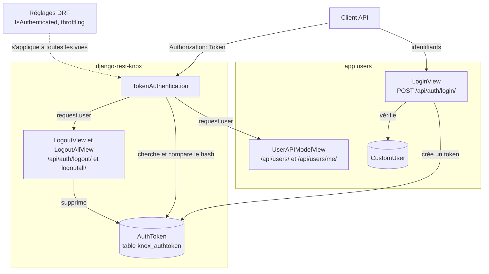
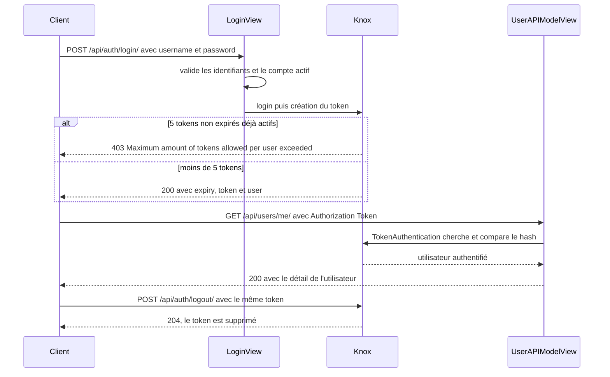
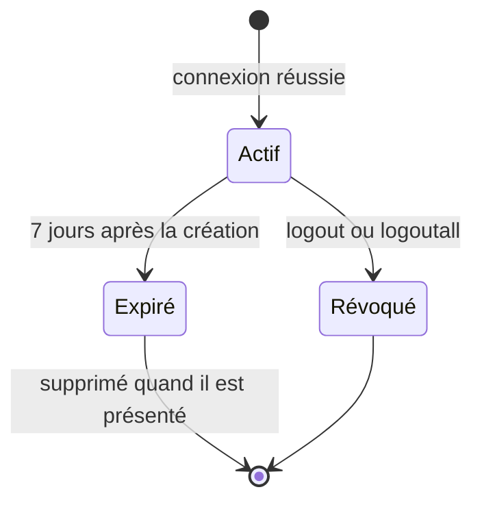

# Feature : Authentification par token (Knox)

Dernière vérification : 2026-10-16 · ea36168

## Résumé

L'API GardenIQ authentifie ses clients avec des tokens [django-rest-knox](https://github.com/jazzband/django-rest-knox). Un client échange un identifiant et un mot de passe contre un token valable 7 jours, puis l'envoie dans l'en-tête `Authorization: Token <token>`. Un utilisateur peut avoir 5 tokens actifs au maximum. Par défaut, toute l'API exige un utilisateur authentifié.

## Contexte

Les clients de l'API (application web, scripts, appareils) ont besoin d'une authentification sans session partagée, révocable appareil par appareil. Knox stocke uniquement un hash (SHA-512) de chaque token : une fuite de la base ne donne pas de token utilisable. Chaque connexion crée un token distinct, ce qui permet de se déconnecter d'un seul appareil (`logout`) ou de tous (`logoutall`).

Le modèle utilisateur est `users.CustomUser` (`AUTH_USER_MODEL`), une extension d'`AbstractUser` avec une adresse e-mail unique.

## Architecture



*Composants de l'authentification : seule la connexion est publique, toutes les autres vues passent par `TokenAuthentication`.*

La vue de connexion (`LoginView`, `gardeniq/users/views/auth.py`) étend celle de Knox : elle est publique (`AllowAny`), valide les identifiants avec l'`AuthTokenSerializer` de DRF, ouvre aussi une session Django (`login()`), puis laisse Knox créer le token. La déconnexion (`logout/`, `logoutall/`) utilise les vues Knox telles quelles. L'action `me` est dans `UserAPIModelView`, avec le CRUD des utilisateurs.

## Flux / Comportement



*Un cycle complet : connexion, appel authentifié, déconnexion. Les identifiants invalides (400) et le dépassement de la limite de débit (429) sont décrits plus bas.*

Exemple déroulé : `alice` se connecte depuis son navigateur et reçoit le token T1 (expiration dans 7 jours). Elle se connecte aussi depuis un script : T2. Chaque appel envoie son propre token. `POST /api/auth/logout/` avec T1 supprime T1 seulement ; T2 reste valable. `POST /api/auth/logoutall/` supprimerait tous ses tokens.



*Cycle de vie d'un token. L'expiration est fixe : il n'y a pas de prolongation automatique (`AUTO_REFRESH = False`).*

## Configuration & Utilisation

### Réglages Knox (`gardeniq/settings/third_party/knox.py`)

| Clé | Valeur | Effet |
|---|---|---|
| `TOKEN_TTL` | 7 jours | Durée de vie d'un token, comptée depuis sa création |
| `TOKEN_LIMIT_PER_USER` | 5 | Nombre maximal de tokens non expirés par utilisateur |
| `AUTO_REFRESH` | `False` | Pas de prolongation à l'usage |
| `MIN_REFRESH_INTERVAL` | 60 | Sans effet tant que `AUTO_REFRESH` est à `False` |
| `AUTH_TOKEN_CHARACTER_LENGTH` | 64 | Le token fait 64 caractères hexadécimaux |
| `SECURE_HASH_ALGORITHM` | `hashlib.sha512` | Algorithme du hash stocké en base |
| `USER_SERIALIZER` | `UserDetailReadOnlySerializer` | Représentation de l'utilisateur renvoyée à la connexion |
| `EXPIRY_DATETIME_FORMAT` | `%Y-%m-%dT%H:%M:%S.%fZ` | Format de `expiry` |
| `AUTH_HEADER_PREFIX` | `Token` (défaut Knox, non surchargé) | Préfixe attendu dans `Authorization` |

La table `knox_authtoken` contient : `digest` (hash, 128 caractères), `token_key` (15 premiers caractères du token, pour la recherche), `user`, `created` et `expiry`.

### Réglages DRF (`gardeniq/settings/third_party/rest_framework.py`)

| Clé | Valeur | Effet |
|---|---|---|
| `DEFAULT_AUTHENTICATION_CLASSES` | `knox.auth.TokenAuthentication` | Seule authentification en production |
| `DEFAULT_PERMISSION_CLASSES` | `IsAuthenticated` | Toute vue exige un utilisateur connecté, sauf surcharge |
| `DEFAULT_THROTTLE_CLASSES` | `AnonRateThrottle`, `UserRateThrottle` | Limites de débit par défaut |
| `DEFAULT_THROTTLE_RATES` | `anon` 20/heure, `user` 200/heure | Valeurs des deux limites ci-dessus |

`gardeniq/settings/dev.py` ajoute aussi `SessionAuthentication` (pour Swagger UI) : voir « Points d'attention ».

### Points d'accès

| Requête | Accès | Réponses |
|---|---|---|
| `POST /api/auth/login/` | Public, limité à 5 requêtes par minute et par IP | 200 `{expiry, token, user}` ; 400 identifiants invalides ou compte inactif ; 403 limite de 5 tokens atteinte ; 429 trop de tentatives |
| `POST /api/auth/logout/` | Token valide | 204 ; 401 |
| `POST /api/auth/logoutall/` | Token valide | 204 ; 401 |
| `GET /api/users/me/` | Tout utilisateur authentifié | 200 détail de l'utilisateur (groupes et permissions inclus) ; 401 |

Gestion des utilisateurs (`/api/users/`) : « administrateur » veut dire `is_staff`.

| Action | Accès |
|---|---|
| `GET /api/users/` (liste), `POST /api/users/` (création), `DELETE /api/users/{id}/` | Administrateur |
| `GET /api/users/{id}/`, `PUT /api/users/{id}/` | Le propriétaire du compte ou un administrateur |
| `PATCH` | 405, non exposé |

À la création, `username` est unique, `password` et `password_confirm` sont obligatoires, identiques, d'au moins 8 caractères et validés par les validateurs de mot de passe de Django, et `email` est unique s'il est fourni. `is_staff` n'est pas modifiable par l'API ; seuls les administrateurs peuvent attribuer des groupes (`group_ids`) ou des permissions (`permission_ids`).

### Exemple

```bash
# 1. Connexion
curl -X POST http://localhost:8000/api/auth/login/ \
  -H "Content-Type: application/json" \
  -d '{"username": "alice", "password": "<mot de passe>"}'
```

```json
{
  "expiry": "2026-10-23T14:57:25.303818Z",
  "token": "<64 caractères hexadécimaux>",
  "user": {
    "id": 1,
    "username": "alice",
    "email": "alice@example.com",
    "first_name": "",
    "last_name": "",
    "is_active": true,
    "is_staff": false,
    "last_login": "2026-10-16T14:57:25.300000Z",
    "date_joined": "2026-10-01T08:00:00.000000Z",
    "groups": [],
    "user_permissions": []
  }
}
```

```bash
# 2. Appel authentifié
curl http://localhost:8000/api/users/me/ -H "Authorization: Token <token>"

# 3. Déconnexion de cet appareil
curl -X POST http://localhost:8000/api/auth/logout/ -H "Authorization: Token <token>"
```

Le même enchaînement en Python :

```python
import requests

base = "http://localhost:8000/api"
login = requests.post(f"{base}/auth/login/", json={"username": "alice", "password": "<mot de passe>"})
login.raise_for_status()
headers = {"Authorization": f"Token {login.json()['token']}"}

print(requests.get(f"{base}/users/me/", headers=headers).json()["username"])
requests.post(f"{base}/auth/logout/", headers=headers)
```

## Points d'attention

- **En-tête exact.** `Authorization: Token <token>`. Avec `Bearer <token>`, l'API répond 401 « Authentication credentials were not provided. ». Un token inconnu ou expiré donne 401 « Invalid token. ».
- **Limite de 5 tokens.** La 6ᵉ connexion renvoie 403 `{"error": "Maximum amount of tokens allowed per user exceeded."}` tant qu'un token n'est pas révoqué ou expiré. Les tokens expirés ne comptent pas.
- **Limite de débit.** `LoginView` n'utilise que `LoginThrottle` (5 requêtes par minute et par adresse, tentatives échouées comprises) : la 6ᵉ renvoie 429 avec un en-tête `Retry-After`. Les réglages `login` (10/heure) et `register` (3/heure) de `DEFAULT_THROTTLE_RATES` ne sont utilisés par aucune vue. En développement, un client déjà authentifié par son cookie de session n'est plus soumis à la limite anonyme.
- **Message unique.** Mauvais mot de passe, identifiant inconnu et compte inactif donnent la même réponse 400 : `Unable to log in with provided credentials.`
- **Session Django en plus du token.** `LoginView` appelle `django.contrib.auth.login` : la réponse pose un cookie `sessionid`. En production il n'est pas utilisé par l'API (seul Knox authentifie) ; en développement, `SessionAuthentication` l'accepte, pour Swagger UI.
- **Token affiché une seule fois.** Seul le hash est stocké : un token perdu ne se récupère pas, il faut se reconnecter. L'expiration est fixe (7 jours) : le client doit se reconnecter à la date `expiry`.
- **Déconnexion.** `logout/` supprime le token présenté, `logoutall/` tous ceux de l'utilisateur. Les deux exigent un token valide.
- **CORS.** `django-cors-headers` est installé (application et middleware), mais aucun réglage `CORS_*` n'est défini dans les settings : un navigateur ne peut appeler l'API depuis une autre origine que si ces réglages sont ajoutés.
- **HTTPS.** Le token circule en clair dans l'en-tête : n'exposer l'API qu'en HTTPS. Les settings communs posent `SECURE_PROXY_SSL_HEADER`, et ceux de production ajoutent `SESSION_COOKIE_SECURE` et `CSRF_COOKIE_SECURE`.

## Tests & Vérification

```bash
pytest -- gardeniq/users/tests/tests_views/test_auth.py gardeniq/users/tests/tests_views/test_users.py
```

Les tests de `gardeniq/users` (121 au 2026-10-16) passent. Ils couvrent la connexion (identifiants valides, invalides, manquants, compte inactif, limite de débit, création d'un token, plusieurs connexions), la limite de 5 tokens (403, libération par déconnexion, tokens expirés non comptés), l'expiration d'un token, sa durée de vie, le refus de l'en-tête `Bearer`, `me`, la déconnexion simple et totale, et les droits du CRUD des utilisateurs. Le test du préfixe `Bearer` utilise un client sans cookie de session : en développement, `SessionAuthentication` authentifierait sinon la requête par le cookie posé à la connexion.

Recette manuelle : lancer `pipenv run server`, jouer les trois commandes `curl` de l'exemple, puis vérifier qu'un nouvel appel avec le token déconnecté renvoie 401.

## Fichiers clés

| Chemin | Rôle |
|---|---|
| `gardeniq/users/views/auth.py` | `LoginView` (connexion publique, limite de débit) |
| `gardeniq/users/views/users.py` | `UserAPIModelView` : CRUD des utilisateurs, action `me`, permissions |
| `gardeniq/users/api_urls.py` | Routes `/api/auth/` et `/api/users/` |
| `gardeniq/users/serializers/users.py` | Validation des utilisateurs, serializers de lecture et de détail |
| `gardeniq/users/models.py` | `CustomUser` |
| `gardeniq/settings/third_party/knox.py` | Réglages Knox |
| `gardeniq/settings/third_party/rest_framework.py` | Authentification, permissions et débit par défaut |
| `gardeniq/settings/django/auth.py` | `AUTH_USER_MODEL`, validateurs de mot de passe |
| `gardeniq/settings/dev.py` | `SessionAuthentication` en développement |
| `gardeniq/users/tests/tests_views/` | Tests de connexion, déconnexion, `me` et utilisateurs |

## Références

- Ticket `TK-38`, PR #8 (« token authentication and endpoint users »).
- [Documentation django-rest-knox](https://jazzband.github.io/django-rest-knox/)
- [Authentification dans Django REST Framework](https://www.django-rest-framework.org/api-guide/authentication/)
- Voir aussi : `.claude/rules/api.md` (règles d'accès des vues), `docs/backlog.md` (écarts connus).
