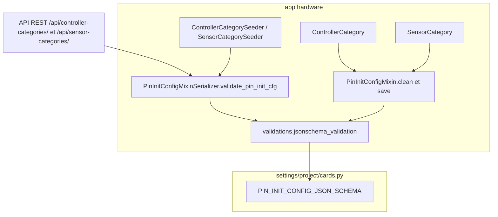
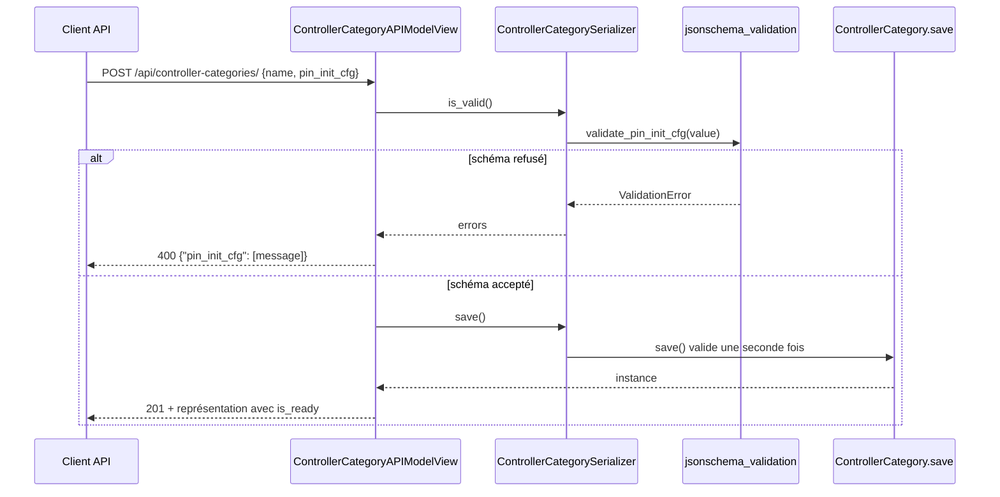

# Feature : champ JSON `pin_init_cfg` (catégories de capteur et de contrôleur)

Dernière vérification : 2026-10-29 · c2dd4d4

## Résumé

`pin_init_cfg` décrit comment la carte MicroPython doit instancier l'objet qui pilote une broche : quelle classe du module `machine` et avec quels arguments. Le champ est porté par `ControllerCategory` et `SensorCategory` (mixin `PinInitConfigMixin`). Il est obligatoire et validé par un schéma JSON (`PIN_INIT_CONFIG_JSON_SCHEMA`) à l'écriture par l'API et à chaque `save()` du modèle. Pour l'instant, le back stocke et valide ce champ : aucune trame USB ne l'envoie encore à la carte.

## Contexte

Un capteur ou un contrôleur est relié à une broche (`Pin`) d'une carte (`Device`). Sa catégorie dit à la carte comment utiliser cette broche : lire une tension (`ADC`), piloter une sortie (`Pin`), générer un signal (`PWM`). Le JSON décrit une **catégorie**, jamais une broche précise : le numéro de broche n'y figure pas, il vient de `Pin.pin_number` et s'écrit `"@pin"`.

Avant TK-74, le champ avait `default=dict` et n'était pas validé. Un premier format verbeux (`channel_class`, `arguments`, `skip_this_arg`, `value_type`…) a été abandonné au profit d'un format court, lisible et sans conversion, décrit dans la page Notion « JSON Config pour le champ pin_init_cfg » (section « Format retenu »).

## Architecture



*Les deux points de validation, serializer et modèle, appellent la même fonction avec le même schéma.*

La validation est faite à trois endroits et c'est voulu : le serializer renvoie une erreur 400 à l'API, `clean()` alimente les formulaires de modèle (admin), et `save()` protège toutes les autres écritures (shell, seeders, code métier). `jsonschema_validation` lève une `django.core.exceptions.ValidationError` ; le serializer la convertit en `rest_framework.serializers.ValidationError`.

## Flux / Comportement



*Création d'une catégorie de contrôleur par l'API ; le PUT suit le même chemin.*

### Format

```json
{"c": "PWM", "a": {"dest": "@pin", "freq": 1000, "duty_u16": 512}}
```

| Clé | Rôle | Règle du schéma |
|---|---|---|
| `c` | Classe MicroPython à instancier | Valeur parmi `"PWM"`, `"Pin"`, `"ADC"` (liste blanche `MP_MACHINE` du firmware) |
| `a` | Arguments du constructeur, `{"nom": valeur}` | Objet ; au moins un argument de premier niveau vaut `"@pin"` |
| autre clé | — | Refusée (`additionalProperties: false`) |

Les noms d'arguments ne sont pas listés exprès : un argument ajouté ou renommé par une mise à jour de MicroPython ne demande aucun changement du back. Un argument inutilisé est simplement absent.

### Valeurs d'un argument de premier niveau

| Écriture | Signification | Règle du schéma |
|---|---|---|
| `"@pin"` | Numéro de broche (`Pin.pin_number`) | Obligatoire au moins une fois dans `a` |
| `"@:NOM"` | Constante `NOM` de la classe `c` (ex. `"@:IN"` avec `"c": "Pin"` = `machine.Pin.IN`) | `NOM` en majuscules : `^[A-Z][A-Z0-9_]*$` |
| autre chaîne commençant par `@` | — | Refusée (`"@foo"`, `"@:in"`, `"@@pin"`) |
| nombre, booléen, `null`, chaîne, liste, objet | Littéral transmis tel quel | Chaînes « frame safe » à toute profondeur |

Une chaîne est **frame safe** si elle ne contient ni espace blanc (espace, tabulation, retour à la ligne) ni `;` : ces caractères séparent les blocs et les champs d'une trame USB. La règle s'applique aux valeurs et aux noms d'arguments, aussi dans les listes et objets imbriqués. Seules les valeurs de premier niveau de `a` sont interprétées comme références : `"@foo"` dans une liste imbriquée est un littéral accepté, et un `"@pin"` imbriqué ne compte pas pour la règle « au moins un `@pin` ».

### Exemples valides

```json
{"c": "Pin", "a": {"id": "@pin", "mode": "@:IN"}}
{"c": "ADC", "a": {"id": "@pin"}}
{"c": "PWM", "a": {"dest": "@pin", "freq": 1000, "duty_u16": 512}}
```

## Configuration & Utilisation

| Élément | Valeur actuelle | Effet |
|---|---|---|
| `settings.PIN_INIT_CONFIG_JSON_SCHEMA` | Schéma JSON draft 2020-12 (`settings/project/cards.py`) | Règles décrites ci-dessus |
| Valeur par défaut du champ | Aucune | Champ obligatoire en base, à l'API et dans les seeders |
| Liste blanche `c` | `PWM`, `Pin`, `ADC` | Une nouvelle classe demande une mise à jour du firmware **et** de l'`enum` du schéma |
| Sérialisation | `List*ReadOnlySerializer` masque `pin_init_cfg` ; `Detail*` et le serializer d'écriture l'affichent | La liste reste légère |
| Seeders | `fixtures/sources/controller_categories.json`, `sensor_categories.json` | `./manage.py seed --app hardware [--update]` |

```bash
curl -X POST http://localhost:8000/api/controller-categories/ \
  -H "Authorization: Token <jeton>" -H "Content-Type: application/json" \
  -d '{"name": "Relais", "pin_init_cfg": {"c": "Pin", "a": {"id": "@pin"}}}'
```

Même appel sur `/api/sensor-categories/`, avec `unity_value` en plus.

## Points d'attention

- **Admin Django.** Le schéma est vérifié par `clean()` (appelé par `full_clean()`, donc par le formulaire d'admin) et par `save()` : l'erreur s'affiche sous le champ. `clean()` ignore une valeur `None`, déjà signalée par le formulaire comme manquante ou mal formée. Un texte d'aide sur le format s'affiche sous le champ (`PIN_INIT_CFG_HELP_TEXT`, `hardware/admin.py`).
- **Le back ne vérifie pas que la constante existe.** `"@:FOO"` est accepté s'il est en majuscules ; seule la carte sait si `machine.<c>.FOO` existe et répond `ERR` sinon.
- **`"@:NOM"` ne vise que la classe `c`.** Une constante d'une autre classe demanderait une nouvelle forme (`"@Classe.NOM"`), absente du schéma.
- **Pas d'échappement du `@`.** Toute chaîne de premier niveau qui commence par `@` doit être une référence valide ; `"@@pin"` est refusé.
- **Changer le format est un changement de protocole.** Les cartes déjà flashées gardent l'ancien firmware : faire évoluer le schéma avec le firmware.
- **Pas encore envoyé à la carte.** Aucune trame USB (`hardware/protocols/`) n'utilise `pin_init_cfg` aujourd'hui ; l'envoi minifié prévu est `json.dumps(data, separators=(",", ":"))`.

## Tests & Vérification

```bash
pytest -n auto --reuse-db -- gardeniq/hardware/tests/tests_models/test_controller.py gardeniq/hardware/tests/tests_models/test_sensor.py
pytest -n auto --reuse-db -- gardeniq/hardware/tests/tests_serializers/test_controller.py gardeniq/hardware/tests/tests_serializers/test_sensor.py
pytest -n auto --reuse-db -- gardeniq/hardware/tests/tests_views/test_controller.py gardeniq/hardware/tests/tests_views/test_sensor.py
pytest --reuse-db -- gardeniq/hardware/tests/tests_seeders
pytest --reuse-db -- gardeniq/hardware/tests/test_admin.py
```

Les cas refusés par le schéma sont listés dans `TestControllerCategoryPinInitCfg.test_save_rejects_invalid_pin_init_cfg` (un cas par règle).

## Fichiers clés

| Chemin | Rôle |
|---|---|
| `gardeniq/settings/project/cards.py` | `PIN_INIT_CONFIG_JSON_SCHEMA` |
| `gardeniq/hardware/validations.py` | `jsonschema_validation` (schéma → `ValidationError` Django) |
| `gardeniq/hardware/models/mixins.py` | `PinInitConfigMixin` : champ et validation dans `clean()` et `save()` |
| `gardeniq/hardware/admin.py` | Textes d'aide des champs JSON (`JSONHelpTextAdminMixin`) |
| `gardeniq/hardware/serializers/mixins.py` | `PinInitConfigMixinSerializer.validate_pin_init_cfg` |
| `gardeniq/hardware/models/controller.py`, `models/sensor.py` | `ControllerCategory`, `SensorCategory` |
| `gardeniq/hardware/serializers/controller.py`, `serializers/sensor.py` | Serializers écriture, liste, détail, seeder |
| `gardeniq/hardware/fixtures/sources/controller_categories.json`, `sensor_categories.json` | Catégories initiales |

## Références

- Ticket TK-74 « Appliquer le diagramme de relation » ([Notion](https://app.notion.com/p/3b454287aae080c3a0e5d15b6c2de667)).
- Notion : [JSON Config pour le champ pin_init_cfg](https://app.notion.com/p/34954287aae0804ab7d7f9ced8e4d62d), [Sensor et Controller objets](https://app.notion.com/p/34954287aae0808288a6e215648c4ff2).
- Documentation MicroPython : [machine.Pin](https://docs.micropython.org/en/latest/library/machine.Pin.html), [machine.ADC](https://docs.micropython.org/en/latest/library/machine.ADC.html), [machine.PWM](https://docs.micropython.org/en/latest/library/machine.PWM.html).
- Voir aussi :
  - [`docs/features/pins-configuration.md`](pins-configuration.md) : la datasheet d'une carte (`DeviceCategory`).
