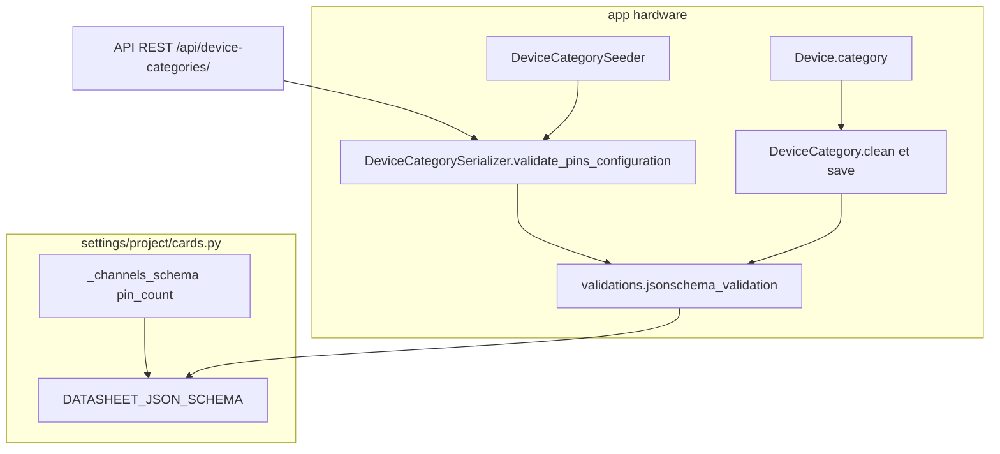
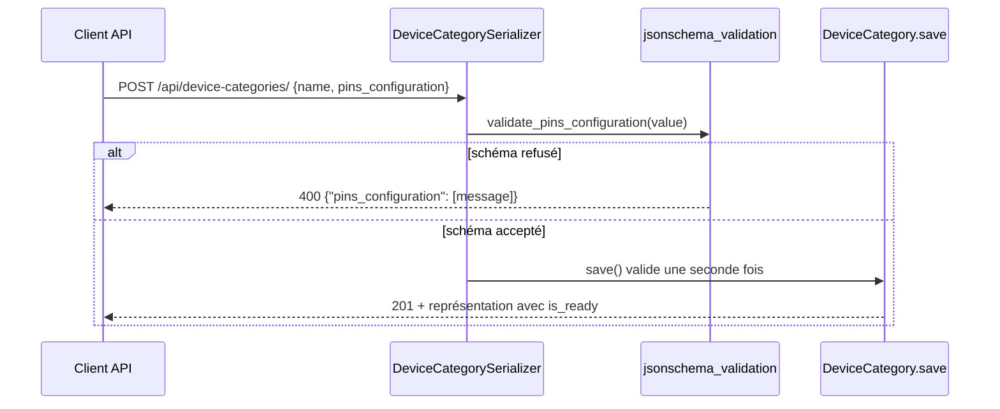

# Feature : champ JSON `pins_configuration` (datasheet d'une carte)

Dernière vérification : 2026-10-29 · c2dd4d4

## Résumé

`pins_configuration` est la datasheet d'une catégorie de carte (`DeviceCategory`, ex. Raspberry Pi Pico) : les types de canaux qu'elle propose et, par type, ses canaux avec leurs broches. Le champ est obligatoire et validé par `DATASHEET_JSON_SCHEMA` à l'écriture par l'API et à chaque `save()` du modèle. Aujourd'hui, le back stocke et valide la datasheet. Il ne s'en sert pas encore pour contrôler les `Pin` ou les `Channel`.

## Contexte

Chaque carte (`Device`) appartient à une catégorie qui décrit son matériel une fois pour toutes. La datasheet permet de savoir quelles broches existent et ce qu'elles savent faire (numérique, PWM, analogique, bus I2C, SPI, UART), sans recopier ces informations sur chaque carte.

La page Notion « Device Category » appelait ce champ `setup_pins`. Le code l'a nommé `pins_configuration`. TK-74 l'a rendu obligatoire (plus de valeur par défaut), a ajouté la validation et le seeder, et a factorisé le schéma (fonction `_channels_schema`) sans en changer le comportement.

## Architecture



*Le serializer et le modèle valident avec le même schéma ; un `Device` référence sa catégorie en `PROTECT`.*

Le serializer renvoie une erreur 400 à l'API, `clean()` alimente les formulaires de modèle (admin), et `save()` protège toutes les autres écritures (shell, seeders, code métier).

## Flux / Comportement



*Création d'une catégorie de carte ; le PUT suit le même chemin.*

### Format

```json
{
  "available_channels": ["digit", "analog"],
  "digits":  [{"name": "GP0", "pins": [0]}, {"name": "GP1", "pins": [1]}],
  "pwms":    [{"name": "PWM0", "pins": [0]}],
  "analogs": [{"name": "ADC0", "pins": [26]}],
  "i2cs":    [{"name": "I2C0", "pins": [0, 1]}],
  "spis":    [{"name": "SPI0", "pins": [0, 1, 2, 3]}],
  "uarts":   [{"name": "UART0", "pins": [0, 1]}]
}
```

| Clé | Obligatoire | Contenu | Broches par canal (positions typées) |
|---|---|---|---|
| `available_channels` | oui | Liste de chaînes : types de canaux proposés | — |
| `digits` | oui | Liste de canaux `{"name": str, "pins": [int]}` | 1 |
| `pwms` | oui | idem | 1 |
| `analogs` | oui | idem | 1 |
| `i2cs` | non | idem | 2 |
| `spis` | non | idem | 4 |
| `uarts` | non | idem | 2 |

Dans chaque canal, `name` et `pins` sont obligatoires. Une liste vide est acceptée pour un type obligatoire : `{"available_channels": [], "digits": [], "pwms": [], "analogs": []}` est la plus petite datasheet valide.

## Configuration & Utilisation

| Élément | Valeur actuelle | Effet |
|---|---|---|
| `settings.DATASHEET_JSON_SCHEMA` | Schéma JSON draft 2020-12 (`settings/project/cards.py`) | Règles décrites ci-dessus |
| Valeur par défaut du champ | Aucune | Champ obligatoire en base, à l'API et dans le seeder |
| Sérialisation | `DeviceCategoryListReadOnlySerializer` masque le champ ; détail et écriture l'affichent | La liste reste légère |
| Seeder | `fixtures/sources/device_categories.json` : Raspberry Pi Pico (`seed_id` 1) | `./manage.py seed --app hardware [--update]` |

```bash
curl -X POST http://localhost:8000/api/device-categories/ \
  -H "Authorization: Token <jeton>" -H "Content-Type: application/json" \
  -d '{"name": "Carte de test", "pins_configuration": {"available_channels": ["digit"], "digits": [{"name": "GP0", "pins": [0]}], "pwms": [], "analogs": []}}'
```

## Points d'attention

- **Nombre et type de broches non contrôlés au-delà des positions listées.** `prefixItems` ne type que les positions décrites : `pins: []` est accepté, `pins: [1, "x"]` aussi pour un canal à une broche, et un `i2cs` avec une seule broche passe. Seule une broche non entière à une position listée est refusée. Entrée n°14 de `docs/backlog.md`.
- **Schéma ouvert.** Les clés inconnues, au premier niveau comme dans un canal, sont acceptées. Les valeurs de `available_channels` sont des chaînes libres, non reliées aux clés présentes ni au modèle `Channel`.
- **Aucun lien avec `Pin`.** Le back ne vérifie pas qu'un `Pin.pin_number` ou un canal choisi existe dans la datasheet de la carte.
- **Admin Django.** Le schéma est vérifié par `clean()` (formulaire d'admin) et par `save()` : l'erreur s'affiche sous le champ, avec un texte d'aide sur le format (`PINS_CONFIGURATION_HELP_TEXT`, `hardware/admin.py`).

## Tests & Vérification

```bash
pytest -n auto --reuse-db -- gardeniq/hardware/tests/tests_models/test_device.py
pytest -n auto --reuse-db -- gardeniq/hardware/tests/tests_serializers/test_device.py
pytest -n auto --reuse-db -- gardeniq/hardware/tests/tests_views/test_device.py
pytest --reuse-db -- gardeniq/hardware/tests/tests_seeders/test_devicecategory.py
pytest --reuse-db -- gardeniq/hardware/tests/test_admin.py
```

## Fichiers clés

| Chemin | Rôle |
|---|---|
| `gardeniq/settings/project/cards.py` | `DATASHEET_JSON_SCHEMA` et `_channels_schema` |
| `gardeniq/hardware/validations.py` | `jsonschema_validation` (schéma → `ValidationError` Django) |
| `gardeniq/hardware/models/device.py` | `DeviceCategory` : champ et validation dans `clean()` et `save()` |
| `gardeniq/hardware/admin.py` | Texte d'aide du champ JSON (`JSONHelpTextAdminMixin`) |
| `gardeniq/hardware/serializers/device.py` | `DeviceCategorySerializer.validate_pins_configuration`, serializers liste, détail et seeder |
| `gardeniq/hardware/fixtures/seeders/devicecategory.py` | `DeviceCategorySeeder` |
| `gardeniq/hardware/fixtures/sources/device_categories.json` | Datasheet du Raspberry Pi Pico |

## Références

- Ticket TK-74 « Appliquer le diagramme de relation » ([Notion](https://app.notion.com/p/3b454287aae080c3a0e5d15b6c2de667)).
- Notion : [Device Category](https://app.notion.com/p/37354287aae0809997b6fc3f0938c7a8), [Ajout d'un nouveau device (micro contrôleur)](https://app.notion.com/p/37354287aae0803b8739e364daa905dc).
- Voir aussi :
  - [`docs/features/pin-init-cfg.md`](pin-init-cfg.md) : la configuration d'initialisation d'une broche (`ControllerCategory`, `SensorCategory`).
