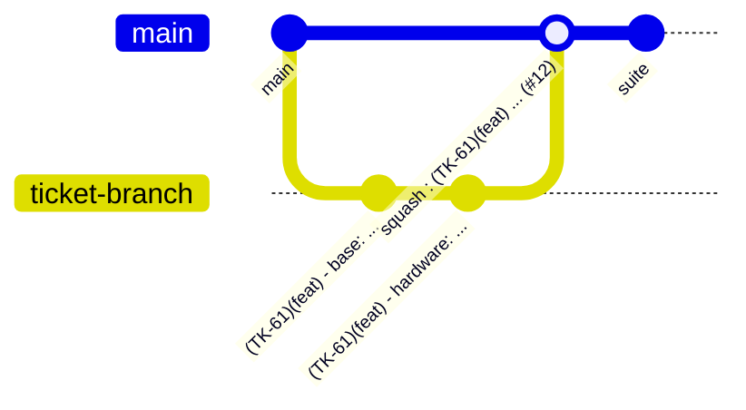

# Gestion des versions avec Git

Ce document décrit comment le projet utilise Git et GitHub : flux de travail, nommage des branches, messages de commit, vérifications avant de pousser et fusion des pull requests. Le résumé à jour pour les agents est dans `CLAUDE.md` (section « Git et GitHub »). Les skills `commit`, `pre-push` et `pr-create` automatisent ces règles.

## Flux de travail

Le projet suit le **GitHub Flow** : une branche courte par ticket, créée depuis `main`, une pull request (PR) par branche, fusion dans `main` après relecture et CI verte.



- Dépôt : `riderflo85/gardenIQ-back`, branche par défaut `main`.
- Le suivi des tickets se fait dans le kanban Notion (« Tableau kanban ») : `TK-<id>` est le champ `Id carte` de la carte (`TK` = « Ticket »). Le statut de la carte suit le travail : `À faire` → `En développement` (branche créée) → `Code review & test` (PR ouverte) → `À merge` (PR relue) → `Fait` (PR fusionnée). Les skills `ticket` et `ticket-create` pilotent ce suivi par le serveur MCP Notion ; voir « Notion » dans `CLAUDE.md`.
- Une CI GitHub Actions tourne à chaque push : `black --check ./gardeniq`, `isort --check-only`, `flake8`, `pytest --cov`.

## Nommage des branches

```
(TK-<id>)(<type>)-<slug>
```

| Élément | Règle |
|---|---|
| `TK-<id>` | numéro de la carte Notion |
| `<type>` | `feat` (fonctionnalité), `fix` (correctif), `enh` (amélioration, interne ou performance), `refactor`, `test`, `docs` ou `chore` |
| `<slug>` | quelques mots en anglais, séparés par des tirets |

Exemples : `(TK-61)(feat)-Optimise-remove-and-add-models`, `(TK-57)(enh)-remove-argument-model`.

Le préfixe `(TK-<id>)(<type>)` de la branche est repris par le hook local sur chaque commit (voir ci-dessous). Le type de la branche est celui du changement principal ; un commit peut porter un autre type, par exemple `docs` pour de la documentation ajoutée dans une branche `feat`.

## Messages de commit

Un commit par changement logique, **en anglais** (décision d'équipe), avec la syntaxe :

```
(TK-<id>)(<type>) - <module>: <Description>
```

Exemple : `(TK-41)(feat) - hardware: Add frame protocol unit tests`.

- **Préfixe automatique.** Le hook local `.git/hooks/prepare-commit-msg` ajoute `(TK-<id>)(<type>) - ` à partir du nom de la branche : il suffit d'écrire `<module>: <Description>`. Pour un autre type que celui de la branche, écrire `(<type>) - <module>: <Description>` : le hook conserve ce type et met le ticket de la branche (un ticket écrit à la main est remplacé par celui de la branche). Ce hook n'est **pas versionné** : une copie fraîche du dépôt ne l'a pas, et chaque collaborateur doit avoir la même version (voir le ticket n°7 de `docs/backlog.md`).
- **Type.** Celui de la branche par défaut. `docs` pour un commit qui ne touche que de la documentation (`docs/`, `README.md`, `CLAUDE.md`, règles et skills), ce qui permet de documenter une feature dans sa propre branche sans changer de branche. Exemple : `(docs) - hardware: Document the USB frame protocol` devient `(TK-41)(docs) - hardware: Document the USB frame protocol`. Les autres types de la liste sont possibles de la même façon quand la nature du commit diffère clairement de celle de la branche.
- **Module.** L'application concernée : `base`, `hardware`, `orderlg`, `telemetry` ou `users`. Pour ce qui est hors des applications : `settings`, `ci`, `docker`, `deps`, `hooks` ou `claude`. Un nouveau module ajouté dans `gardeniq/` s'ajoute à cette liste (ici et dans `CLAUDE.md`).
- **Description.** À l'impératif, première lettre en majuscule, sans point final, titre d'environ 72 caractères. Un corps (séparé par une ligne vide) seulement quand le pourquoi n'est pas évident.
- **Fichiers générés.** Une migration générée fait partie du même commit que le changement de modèle.
- **Hooks pre-commit.** `pre-commit install` installe black, flake8, isort, check-json, end-of-file-fixer et trailing-whitespace sur les fichiers indexés. Ne jamais contourner avec `--no-verify`.

La structure (type, ticket, module) est volontaire : elle permet de retrouver un changement dans l'historique et, plus tard, de générer un changelog.

## Avant de pousser

Le skill `pre-push` déroule cette liste et rend un bilan, sans pousser.

1. **Rebaser sur `main`** si `main` a avancé. Ne pas rebaser une branche déjà poussée sans en parler : cela obligerait à forcer le push, qui est refusé.
2. **Migrations.** Aucune migration déjà présente sur `main` n'est modifiée ou supprimée. `./manage.py makemigrations --check --dry-run` ne signale rien (la CI ne le contrôle pas). Plusieurs migrations ajoutées dans une même app sur la branche sont fusionnées en une seule, uniquement celles de la branche. Détail dans `.claude/rules/migrations.md`.
3. **Documentation.** Si le comportement change, mettre à jour la fiche de référence dans `docs/features/` ou `docs/runbooks/`, et les règles de `CLAUDE.md` et `.claude/rules/` si elles sont touchées.
4. **Traductions.** L'internationalisation est activée mais il n'existe pas encore de fichiers de traduction : si la branche ajoute des chaînes traduisibles, en parler avant d'en générer.
5. **Logs.** Un chemin qui peut échouer ou qui a des effets de bord (protocole USB, seeder, commande) laisse une trace via `logging.getLogger(__name__)`.
6. **Lint et typage.** `black --check gardeniq`, `isort --check-only --diff .` et `flake8 .` passent. Les fonctions écrites ou modifiées sont typées.
7. **Tests.** `pytest -n auto --reuse-db` passe en local (environ 35 s). Après une nouvelle migration, utiliser `--create-db`.
8. **Commits.** Titres au bon format, pas de commit `fixup` ou `WIP`, aucun fichier personnel ou sensible (`.env`, `db.sqlite3`, `CLAUDE.local.md`).

## Fusion des pull requests

Le skill `pr-create` rédige la synthèse et crée la PR avec `gh` ; `pr-create merge` la fusionne. Le dépôt n'a pas de modèle de PR : la description suit la structure du skill (contexte, commits par module, vérifications, fichiers principaux).

À chaque PR :

- **Titre** : `(TK-<id>)(<type>) <description>`. Il devient le message du commit sur `main`.
- **Assigné** : l'auteur. **Reviewer** : à choisir à chaque PR avec l'auteur, jamais automatiquement.
- **Label de type** : `feature`, `bug`, `enhancement`, `refactor`, `documentation`, `test` ou `chore`, selon le type de la branche. La liste évolue au cas par cas.
- **Label de statut** : `ready to review` à l'ouverture (`work in progress` pour un brouillon), puis `ready to merge` avant la fusion.
- **CI verte** et PR ni en brouillon ni en conflit avant de fusionner.

À la fusion :

- **Squash.** Les commits de la PR sont squashés : le titre de la PR, suivi de ` (#<n>)` ajouté par GitHub, devient le message sur `main` (exemple : `(TK-61)(feat) optimise remove and add models (#12)`). Les commits individuels restent écrits selon la syntaxe ci-dessus.
- **Suppression de la branche** source après la fusion.
- Commande : `gh pr merge <n> --squash --delete-branch`. Depuis l'interface web : « Squash and merge », puis supprimer la branche.
- Une fusion demande toujours une confirmation explicite.

L'installation de `gh` est décrite dans `docs/runbooks/installer-gh.md`.

## Après une nouvelle version stable

Il n'existe pas encore de tags ni de processus de release : la version (`1.0.0`) est définie dans `gardeniq/__version__.py`. Quand une version stable est publiée, vérifier :

- **Dépendances.** Les mettre à jour :

  ```bash
  pipenv run update_dep
  ```

  Cette commande régénère `Pipfile.lock`, `requirements.txt` et `requirements_dev.txt`, utilisés par la CI et Docker.
- **Versions de support.** Pour les composants principaux (Python, Django, Django REST Framework), vérifier les versions à support long terme (LTS).
- **Migrations squashées.** Si une app contient une migration squashée déjà déployée partout, retirer sa liste `replaces` et renommer le fichier sans `squashed`. Il n'y en a aucune aujourd'hui.

  ```python
  # Avant : 0001_initial_squashed_0003_update_model.py
  class Migration(migrations.Migration):
      initial = True

      # Supprimer cette liste de remplacement
      replaces = [
          ("base", "0001_initial"),
          ("base", "0002_add_model"),
          ("base", "0003_update_model"),
      ]

      operations = [...]

  # Renommer le fichier : si le squash remplace 0001_initial, il devient 0001_initial.
  # Pour un autre, comme 0005_migration_squashed_0011_other_migration, il devient 0005_migration.

  # Après : 0001_initial.py
  class Migration(migrations.Migration):
      initial = True

      operations = [...]
  ```
