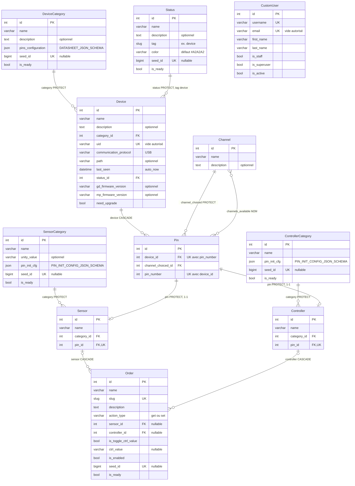

# Modèle de données

Dernière vérification : 2026-10-29 · 719d8a0

Diagramme relationnel des modèles Django du projet (apps `base`, `hardware`, `orderlg`, `users` ; `telemetry` n'a pas encore de modèle). Il est construit à la lecture de `gardeniq/<app>/models/` : les champs hérités des mixins abstraits de `base/models/mixins.py` sont dépliés dans chaque table, et chaque table a une clé primaire `id` automatique.

**À tenir à jour** : tout ajout, modification ou suppression d'un modèle, d'un champ ou d'une relation dans les modèles Django met ce fichier à jour dans le même commit (règle de `CLAUDE.md`).

*Chaque relation porte le nom du champ côté enfant et son `on_delete`. La carte d'un capteur ou d'un contrôleur se lit par sa broche (`sensor.pin.device`, `sensor.pin.pin_number`). `CustomUser` n'est relié à aucun modèle du projet.*

## Contraintes et règles hors du diagramme

| Table | Règle | Où |
|---|---|---|
| `Pin` | Unicité du couple (`device`, `pin_number`) : contrainte `unique_device_pin_number` | `hardware/models/pin.py` |
| `Pin` | `channels_available` passe par la table de jointure implicite `hardware_pin_channels_available` | `hardware/models/pin.py` |
| `Device` | `status` limité aux `Status` dont le `tag` contient `device` (`limit_choices_to`, appliqué par les formulaires, pas par la base) | `hardware/models/device.py` |
| `Order` | Contrainte `check_order_action_type_sensor_controller` : soit un ordre de seeder pas prêt (`seed_id > 0`, `is_ready = False`, ni capteur ni contrôleur), soit `get` avec un capteur ou un contrôleur, soit `set` avec un contrôleur et sans capteur | `orderlg/models/order.py` |
| `DeviceCategory` | `pins_configuration` validé par `DATASHEET_JSON_SCHEMA` (`clean()` et `save()`) | [`features/pins-configuration.md`](features/pins-configuration.md) |
| `ControllerCategory`, `SensorCategory` | `pin_init_cfg` validé par `PIN_INIT_CONFIG_JSON_SCHEMA` (`clean()` et `save()`) | [`features/pin-init-cfg.md`](features/pin-init-cfg.md) |
| `Controller`, `Sensor` | Une broche n'a qu'un propriétaire : `pin` est un `OneToOneField` (unicité dans chaque table, en base), et `PinOwnerMixin` refuse en `clean()` et `save()` une broche déjà prise par l'autre table | `hardware/models/mixins.py`, `hardware/serializers/mixins.py` |

## Mixins abstraits

Les tables ci-dessus reçoivent leurs champs communs de ces mixins (`base/models/mixins.py`, `hardware/models/mixins.py`) :

| Mixin | Champs | Utilisé par |
|---|---|---|
| `NameMixinModel` | `name` | toutes les tables du projet sauf `Pin` et `CustomUser` |
| `OptionalDescriptionMixinModel` / `DescriptionMixinModel` | `description` (optionnelle / obligatoire) | `Status`, `DeviceCategory`, `Device`, `Channel` / `Order` |
| `SeederMixinModel` | `seed_id`, `is_ready` | `Status`, `DeviceCategory`, `ControllerCategory`, `SensorCategory`, `Order` |
| `SlugMixinModel` | `slug` | `Order` |
| `ProtectedDisabledMixinModel` | `is_enabled` | `Order` |
| `PinInitConfigMixin` | `pin_init_cfg` | `ControllerCategory`, `SensorCategory` |
| `PinOwnerMixin` | `pin` (un à un) | `Sensor`, `Controller` |

## Hors diagramme

Les tables des apps tierces ne sont pas représentées : `auth` (groupes et permissions de `CustomUser`), `knox` (jetons d'authentification, liés à `CustomUser`), `admin`, `contenttypes`, `sessions`. `CustomUser` hérite d'`AbstractUser` : seuls ses champs principaux sont listés.
