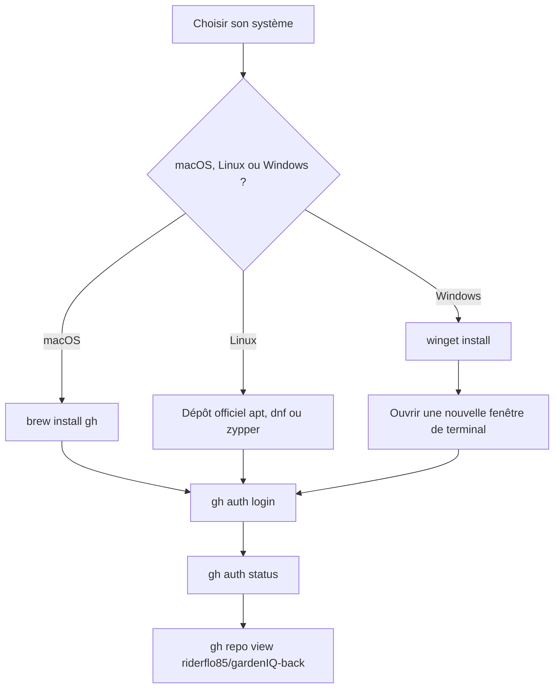

# Procédure : installer et configurer `gh` (GitHub CLI)

Dernière vérification : 2026-10-16 · ea36168

## Résumé

`gh` est la ligne de commande officielle de GitHub. Le projet l'utilise pour créer et fusionner les pull requests (skill `pr-create`), lire l'état de la CI et gérer les labels. Ce runbook décrit son installation sur macOS, Linux et Windows, puis la connexion à GitHub et la vérification.

Les commandes viennent de la documentation officielle (voir « Références »), lue le 2026-10-16. Elles n'ont pas été rejouées sur chaque système : en cas d'écart avec votre machine, la documentation officielle fait foi.

## Prérequis

- Un compte GitHub avec accès au dépôt `riderflo85/gardenIQ-back`.
- `git` installé (le dépôt est déjà cloné).
- Un terminal avec les droits d'installation de paquets (`sudo` sous Linux, droits utilisateur ou administrateur selon la méthode sous Windows).
- Un navigateur sur la machine pour la connexion (flux « web » par défaut).

## Vue d'ensemble



## Étapes

### 1. Installer `gh`

Utiliser de préférence la méthode **officielle** de votre système. Les méthodes « communautaires » ne sont ni maintenues ni supportées par l'équipe de `gh`.

#### macOS

```bash
brew install gh
```

Mise à jour : `brew upgrade gh`.

Sans Homebrew, les binaires précompilés (`amd64` et `arm64`) sont sur la [page des releases](https://github.com/cli/cli/releases/latest). La documentation signale que les installeurs `.pkg` n'étaient pas signés à la date de sa rédaction : préférer Homebrew.

#### Windows

```powershell
winget install --id GitHub.cli --source winget
```

Mise à jour : `winget upgrade --id GitHub.cli --source winget`.

L'installeur modifie le `PATH` : **ouvrir une nouvelle fenêtre** de Windows Terminal (un nouvel onglet ne suffit pas), puis vérifier. Sans WinGet, des installeurs `exe` et `msi` (`386`, `amd64`, `arm64`) sont sur la page des releases.

#### Linux

**Debian, Ubuntu, Raspberry Pi OS (apt)** : utiliser le dépôt officiel de GitHub, pas le paquet `gh` des dépôts de la distribution (des versions communautaires, 2.45 et 2.46, sont cassées par un changement d'API de GitHub).

```bash
(type -p wget >/dev/null || (sudo apt update && sudo apt install wget -y)) \
	&& sudo mkdir -p -m 755 /etc/apt/keyrings \
	&& out=$(mktemp) && wget -nv -O$out https://cli.github.com/packages/githubcli-archive-keyring.gpg \
	&& cat $out | sudo tee /etc/apt/keyrings/githubcli-archive-keyring.gpg > /dev/null \
	&& sudo chmod go+r /etc/apt/keyrings/githubcli-archive-keyring.gpg \
	&& sudo mkdir -p -m 755 /etc/apt/sources.list.d \
	&& echo "deb [arch=$(dpkg --print-architecture) signed-by=/etc/apt/keyrings/githubcli-archive-keyring.gpg] https://cli.github.com/packages stable main" | sudo tee /etc/apt/sources.list.d/github-cli.list > /dev/null \
	&& sudo apt update \
	&& sudo apt install gh -y
```

Mise à jour : `sudo apt update && sudo apt install gh`.

**Fedora, RHEL, CentOS (dnf)** :

```bash
# DNF5 (Fedora récent)
sudo dnf install dnf5-plugins
sudo dnf config-manager addrepo --from-repofile=https://cli.github.com/packages/rpm/gh-cli.repo
sudo dnf install gh

# DNF4
sudo dnf install 'dnf-command(config-manager)'
sudo dnf config-manager --add-repo https://cli.github.com/packages/rpm/gh-cli.repo
sudo dnf install gh
```

Mise à jour : `sudo dnf update gh`. Amazon Linux 2 passe par `yum-config-manager --add-repo` avec la même URL de dépôt, puis `sudo yum install gh`.

**openSUSE, SUSE (zypper)** :

```bash
sudo zypper addrepo https://cli.github.com/packages/rpm/gh-cli.repo
sudo zypper ref
sudo zypper install gh
```

Mise à jour : `sudo zypper ref && sudo zypper update gh`.

**Homebrew sur Linux** : `brew install gh` (mise à jour : `brew upgrade gh`).

**Autres distributions** (paquets communautaires, sans garantie de version) : Arch `sudo pacman -S github-cli`, Alpine `apk add github-cli`, openSUSE Tumbleweed `sudo zypper install gh`, Nix `nix-shell -p gh`. Les binaires précompilés (`386`, `amd64`, `arm64`, `armv6`) existent aussi sur la page des releases.

**À ne pas faire : installer `gh` avec Snap.** L'équipe de `gh` le déconseille explicitement (nombreux problèmes d'exécution).

### 2. Se connecter à GitHub

```bash
gh auth login
```

Répondre aux questions :

- **Hôte** : `GitHub.com`.
- **Protocole Git** : `SSH` pour rester cohérent avec le dépôt (`git@github.com:riderflo85/gardenIQ-back.git`). `gh` détecte vos clés SSH existantes et propose d'en envoyer une sur GitHub ; si vous en avez déjà une configurée, choisissez-la ou passez cette étape (`--skip-ssh-key`).
- **Authentification** : « Login with a web browser » : `gh` affiche un code à usage unique à saisir dans le navigateur (`--clipboard` le copie).

Le jeton est rangé dans le trousseau du système. Si le trousseau n'est pas disponible, `gh` retombe sur un fichier en clair : `gh auth status` indique l'emplacement. Ne pas utiliser `--insecure-storage`.

Les droits par défaut suffisent pour créer et fusionner des PR. Pour un jeton fourni à la main (`gh auth login --with-token`), les droits minimaux sont `repo`, `read:org` et `gist`.

Depuis Claude Code, lancer la commande avec le préfixe `!` pour qu'elle s'exécute dans la session : `! gh auth login`.

## Vérification

```bash
gh --version
gh auth status
gh repo view riderflo85/gardenIQ-back
gh pr list
```

- `gh --version` affiche une version (2.x).
- `gh auth status` indique `Logged in to github.com` et le compte utilisé.
- `gh repo view` affiche la description du dépôt.
- `gh pr list` renvoie la liste des PR ouvertes (éventuellement vide), sans erreur d'authentification.

## Rollback

Désinstaller avec le gestionnaire utilisé pour l'installation :

| Système | Commande |
|---|---|
| macOS (Homebrew) | `brew uninstall gh` |
| Windows (WinGet) | `winget uninstall --id GitHub.cli` |
| Debian, Ubuntu | `sudo apt remove gh` |
| Fedora, RHEL | `sudo dnf remove gh` |
| openSUSE | `sudo zypper remove gh` |

Avant de désinstaller, se déconnecter pour supprimer le jeton stocké : `gh auth logout`. Sur GitHub, on peut aussi révoquer l'autorisation de l'application « GitHub CLI » dans les paramètres du compte. Ces commandes de désinstallation sont celles des gestionnaires de paquets, pas de la documentation de `gh`.

## Points d'attention

- **Windows : nouvelle fenêtre de terminal** après l'installation, sinon `gh` reste introuvable.
- **Dépôts Linux et rotation de clé PGP** : la documentation officielle annonce une rotation de la clé de signature des dépôts Linux effective le 5 septembre 2026. En cas d'erreur de signature à `apt update` ou `dnf`, refaire l'étape du trousseau (téléchargement de `githubcli-archive-keyring.gpg` pour apt) puis consulter l'annonce `cli/cli#13118`.
- **Variable `GH_TOKEN`** : si elle est définie, elle prend le pas sur les identifiants stockés. Un `gh auth status` surprenant vient souvent de là. `GITHUB_TOKEN` sert de repli. Elles servent surtout à la CI.
- **`GH_NO_UPDATE_NOTIFIER=1`** supprime les messages de mise à jour de `gh` ; `NO_COLOR=1` supprime les couleurs.
- **Permissions dans Claude Code** : `.claude/settings.json` autorise sans demande les commandes de lecture (`gh auth status`, `gh pr view`, `gh pr checks`, `gh pr list`, `gh repo view`, `gh label list`) et demande une validation pour `gh pr create`, `gh pr merge`, `gh pr edit` et `gh label create`.
- **Vérifier une release téléchargée** (facultatif, binaires manuels) : `gh at verify -R cli/cli <archive>` ou `cosign verify-blob-attestation`, voir la documentation officielle.
- **Push et authentification** : `gh` sert à l'API GitHub (PR, labels, CI). Le `git push` continue d'utiliser la configuration Git du dépôt (SSH).

## Références

- [Dépôt et README de `gh`](https://github.com/cli/cli#installation)
- [Installation sur macOS](https://github.com/cli/cli/blob/trunk/docs/install_macos.md)
- [Installation sur Windows](https://github.com/cli/cli/blob/trunk/docs/install_windows.md)
- [Installation sur Linux et BSD](https://github.com/cli/cli/blob/trunk/docs/install_linux.md)
- [`gh auth login`](https://cli.github.com/manual/gh_auth_login)
- [Variables d'environnement de `gh`](https://cli.github.com/manual/gh_help_environment)
- Skill du projet : `.claude/skills/pr-create/SKILL.md`
